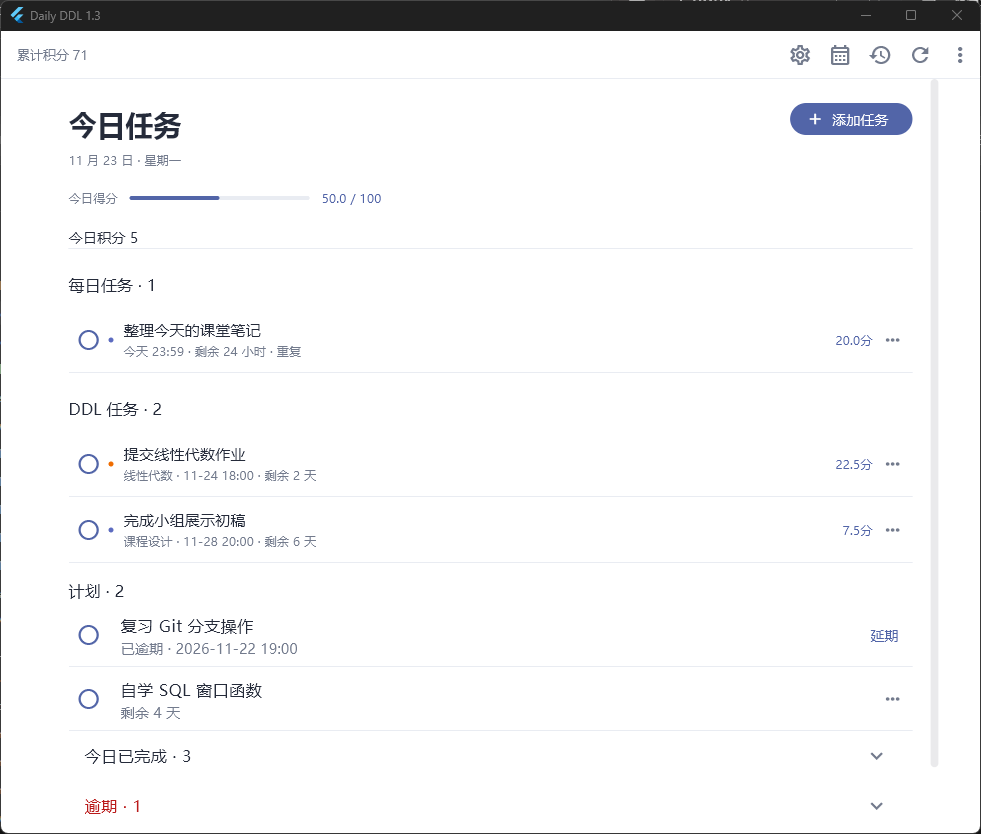
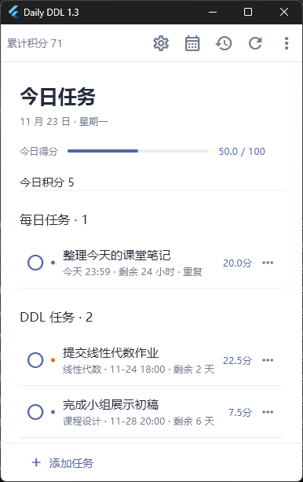
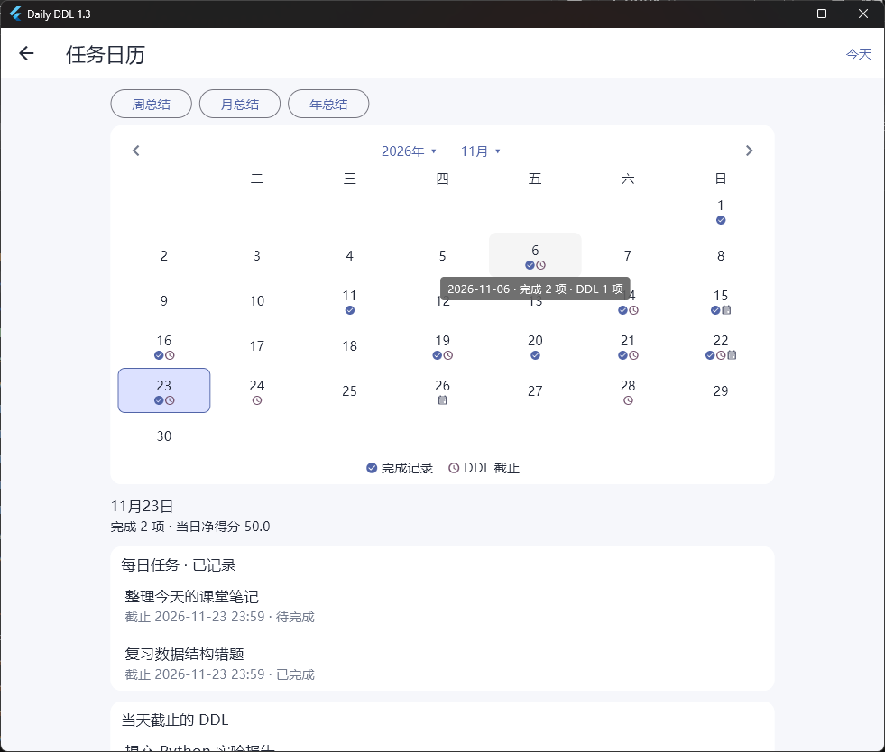
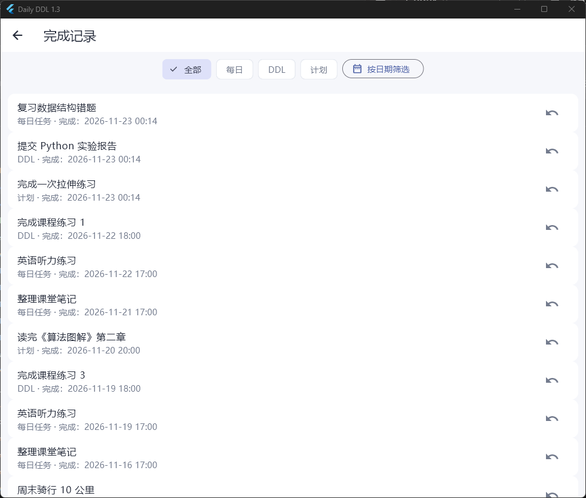
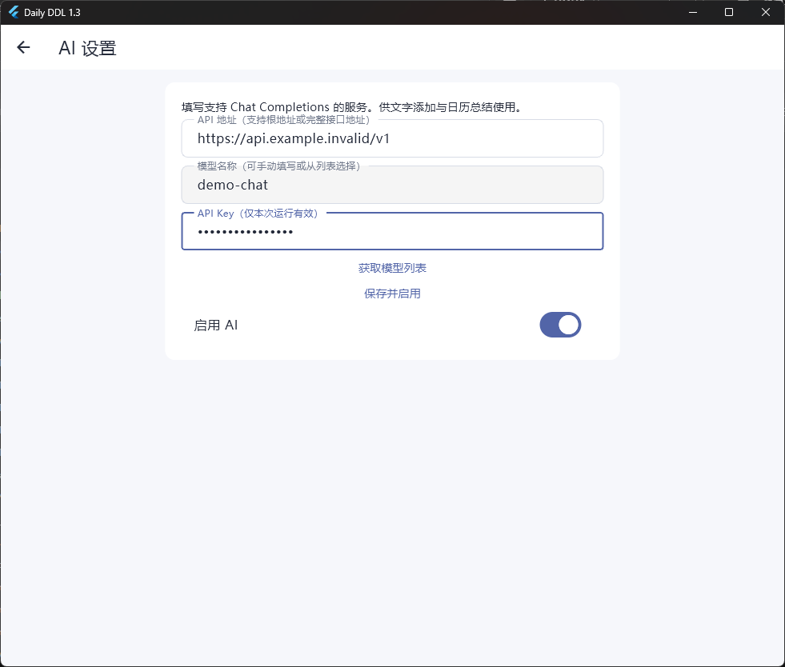
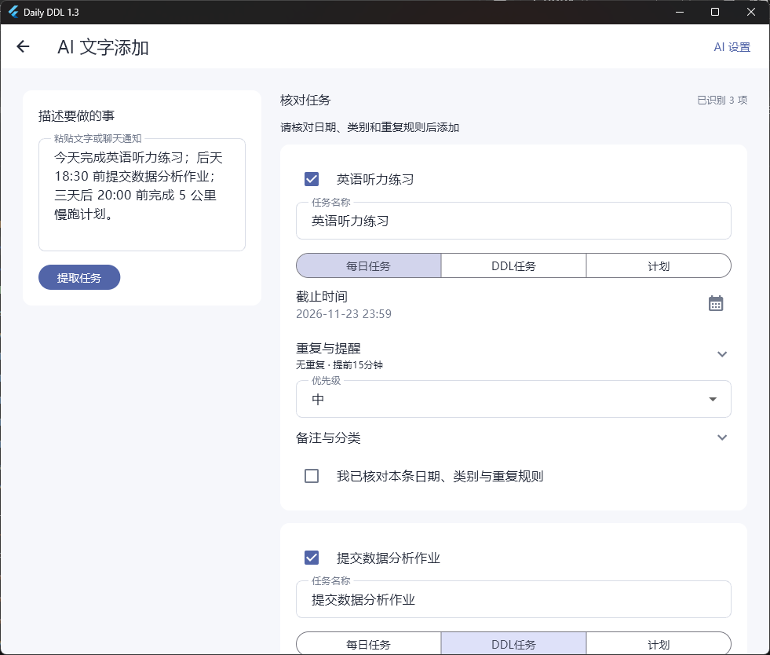
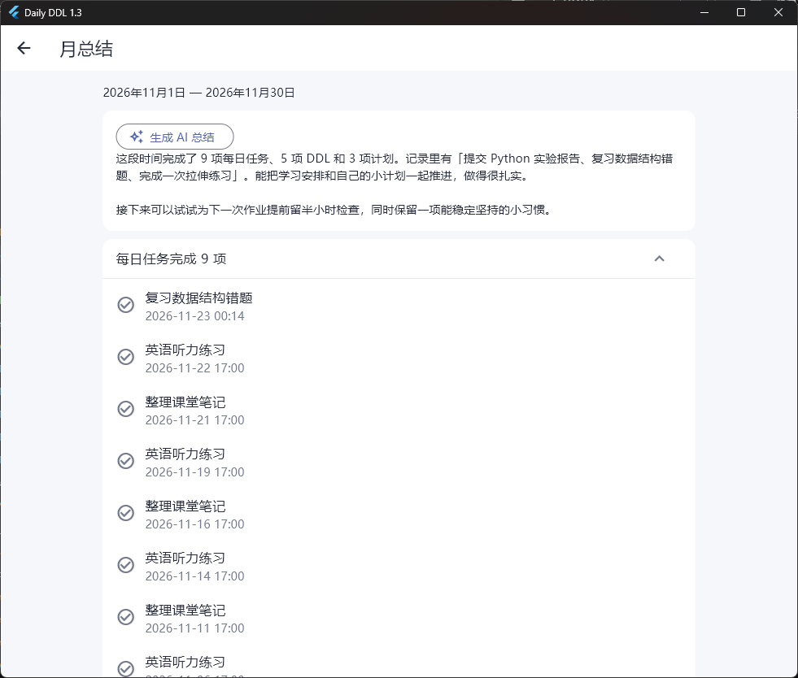

# Daily DDL

Daily DDL 是一个 Windows 桌面待办工具。你可以把每日习惯、作业截止日期和个人计划放在同一个首页，查看剩余时间、勾选完成，也可以把聊天通知交给 AI 整理成待办草稿。

## 下载与运行

1. 在本仓库的 **Releases** 页面下载 **DailyDDL-v1.3.0-windows-x64.zip**。
2. 将整个 ZIP 解压到有写入权限的文件夹。
3. 双击 **daily_ddl.exe**。让 DLL 和 **data** 资源文件夹与程序保持在同一目录。

首次启动会创建空任务库。右上角菜单可切换「桌面精简窗口」、开启窗口置顶或退出应用。需要在关闭窗口后继续接收截止提醒时，可让应用留在系统托盘。

## 管理任务

点首页「添加任务」，填写名称并选择一种任务类型。

| 类型 | 用途 |
| --- | --- |
| 每日任务 | 适合整理笔记、复习和日常习惯，可设置结束时间、重复规则和提醒。 |
| DDL 任务 | 适合有明确截止日期的作业或交付。首页显示倒计时，越临近截止，得分权重越高。 |
| 计划 | 适合自学、阅读或运动，截止时间可选。完成后立即获得累计积分。 |

点击任务左侧的圆圈即可完成，当天的记录会出现在「今日已完成」。可以点完成提示里的「撤销」，也可以进入右上角「完成记录」撤回。

查看桌面精简窗口

## 回顾完成情况

「任务日历」标出完成记录和截止日期。点击某一天可查看任务明细，也可打开周、月或年总结。「完成记录」按实际完成时间排列，每日任务、DDL 和计划可以一起查看，支持按类型、单日或日期范围筛选。

查看任务日历和完成记录

## 用 AI 添加任务和写总结

首次使用时，在「AI 设置」填写支持 Chat Completions 的 HTTPS 接口地址、模型和 API Key。模型可手动填写，也可通过「获取模型列表」选择。API Key 仅在本次运行期间有效。

- **文字添加**。从「添加任务」进入「AI 文字添加」，粘贴聊天通知或描述。提取后可以修改类别和截止时间，核对并确认所选草稿后才会添加。
- **周期总结**。在日历打开周、月或年总结，点击「生成 AI 总结」。确认发送后，AI 会根据所选期间的完成记录生成回顾和下一步建议。

以下截图使用样例任务和本地模拟 AI 响应。

查看 AI 设置、文字添加和月总结

## 得分与累计积分

- **每日任务和 DDL**共享每日 100 分得分池。当天实际得分除以 10 并四舍五入，按本地午夜结算到累计积分。当天应完成的每日任务和到期 DDL 都完成时，额外获得 3 积分。
- **计划**完成后立即加 2 积分。有截止时间且至少提前 24 小时完成时，再加 1 积分。计划奖励独立于每日得分。
- **逾期处理**支持用累计积分归档 DDL，或给逾期计划延期。确认前可以查看费用。

## 从源码运行

使用装有 Windows 桌面开发支持的 Flutter SDK，在项目根目录运行。

~~~powershell
flutter pub get
flutter run -d windows
~~~

生成 Windows x64 发布构建。

~~~powershell
flutter build windows --release
~~~

构建输出位于 **build/windows/x64/runner/Release/**。

## 后续计划

- 完善积分流水界面与奖励兑换。
- 探索从截图提取待办，并沿用草稿核对流程。
- 继续优化精简窗口和桌面提醒体验。
